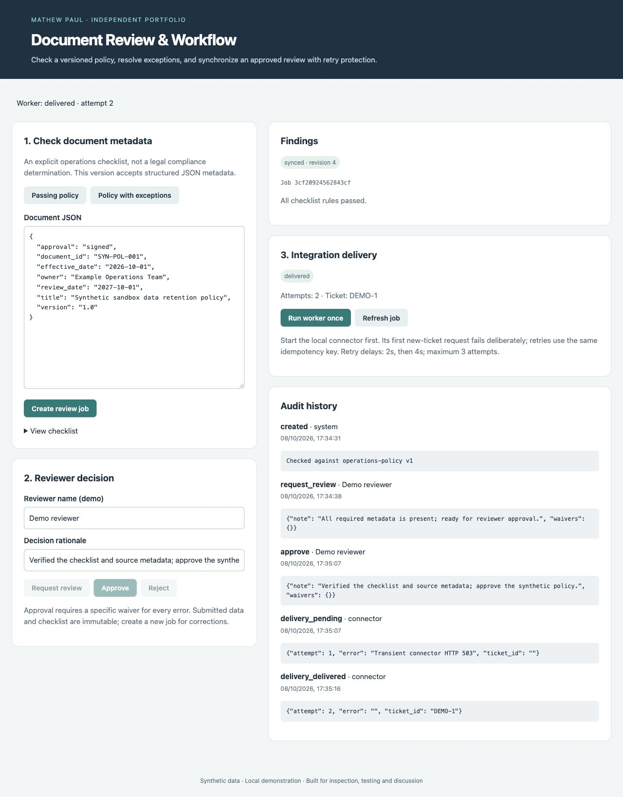

# Document Review & Workflow Automation

An operations reviewer needs explicit, repeatable metadata checks, review accountability and reliable delivery of approved findings to another system.

### Working features

- A versioned JSON checklist with required-field, pattern, date and allowed-value rules.
- Findings tied to field values; the submitted document and checklist snapshot remain immutable.
- Draft → review → approve/reject transitions with optimistic version checks.
- Approval requires a specific reason for each error waiver; events preserve reviewer rationale.
- A durable SQLite outbox with delivery leases, bounded exponential retry and recovery after an expired lease.
- A real local HTTP ticket connector with durable idempotency, transient-failure injection and receipts.

**Stack:** Python, Flask, SQLite, HTTP integration, pytest.



## Setup

Requires Python 3.12+ (verified locally with 3.14.6). Run from this repository:

```sh
python3 -m venv .venv
source .venv/bin/activate
pip install -r requirements-dev.txt
pytest -q
python evaluate.py
python app.py
```

The app binds to localhost. `data/` is created on first run and excluded from Git. `DATABASE_PATH` can select a different SQLite file. Tests and evaluations use temporary databases. The Flask development server is intended for the local demo.

## Evidence and project status

This is a newly built independent portfolio implementation using synthetic data. It does not describe a customer deployment or measured business impact. See [evaluation results](docs/evaluation.json), [architecture](docs/architecture.md), [demo walkthrough](docs/demo.md) and [acceptance criteria](docs/acceptance.md). CI runs the Python tests and reproducible evaluation. Small, authored regression sets are useful checks, not generalization benchmarks.

Open **http://127.0.0.1:8103**.

For integration delivery also run `python connector.py` in a second terminal.

## Demo

1. Start the synthetic connector in a separate terminal: `python connector.py` (port 8104).
2. Start `python app.py` and open http://127.0.0.1:8103.
3. Create a job from **Policy with exceptions**. Inspect four findings and their field evidence.
4. Request review with a rationale. Approval is blocked unless every error has a waiver reason of at least 10 characters. Reject or document the individual waivers.
5. For the simplest delivery demo, create a **Passing policy** job, request review and approve it.
6. Click **Run worker once**. On a fresh connector database, the first new ticket fails with HTTP 503.
7. Wait at least 2 seconds and run the worker again. Expect `delivered`, `synced`, attempt 2 and ticket `DEMO-1`.
8. A further worker tick is idle. Inspect the events to see both failure and recovery.

The connector injects one failure per fresh database, not once per process restart. `DEMO_FAILURES` sets its initial failure count. All data is synthetic.

## Limitations

See the explicit scope and deployment limitations in [architecture](docs/architecture.md).
