# Architecture and decisions

```mermaid
flowchart LR
 A[Structured document metadata] --> B[Versioned checklist]
 B --> C[Findings with field evidence]
 C --> D[Human review]
 D --> E[Version-checked approval and waivers]
 E --> F[(Durable outbox)]
 F --> G[Leased worker attempt]
 G --> H[Local HTTP ticket connector]
 H --> I[Idempotent ticket receipt]
 G --> F
 I --> J[Synced state and audit event]
```

Approval and outbox insertion happen in the same SQLite transaction. Worker attempts claim a 30-second lease and use a 3-second HTTP timeout. Retryable connection errors, 408, 429 and 5xx use delays of 2 seconds and 4 seconds, up to three ordinary attempts. Other HTTP errors fail immediately. A lost lease cannot overwrite a newer worker's result. A crash after connector success can replay the same key safely. The connector rejects key reuse with different content.

`run_worker` processes one due item; use a scheduler/worker loop for unattended operation. This demo exposes an explicit **Run worker once** button so failure and recovery are inspectable. A crash can consume a lease attempt without an HTTP attempt, so the counter is an attempt log, not a guarantee of exactly three network calls across arbitrary crash patterns. Failed items require an operator-led recovery design; automatic dead-letter replay is not implemented.

The checklist is for fictional operations metadata, not legal certification. No OCR, language-model extraction or arbitrary policy interpretation is claimed. Reviewer identity is self-entered in the localhost demo. Production authentication, separation of duties, tamper-evident logs and real Jira/ServiceNow connectors are future work. Audit records are append-only through the API, not cryptographically immutable.
